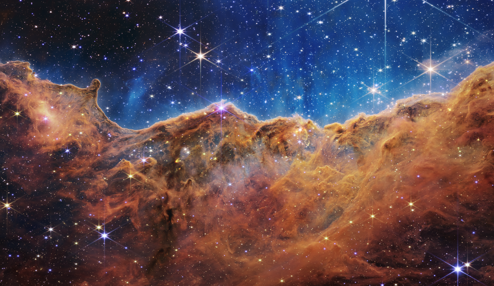
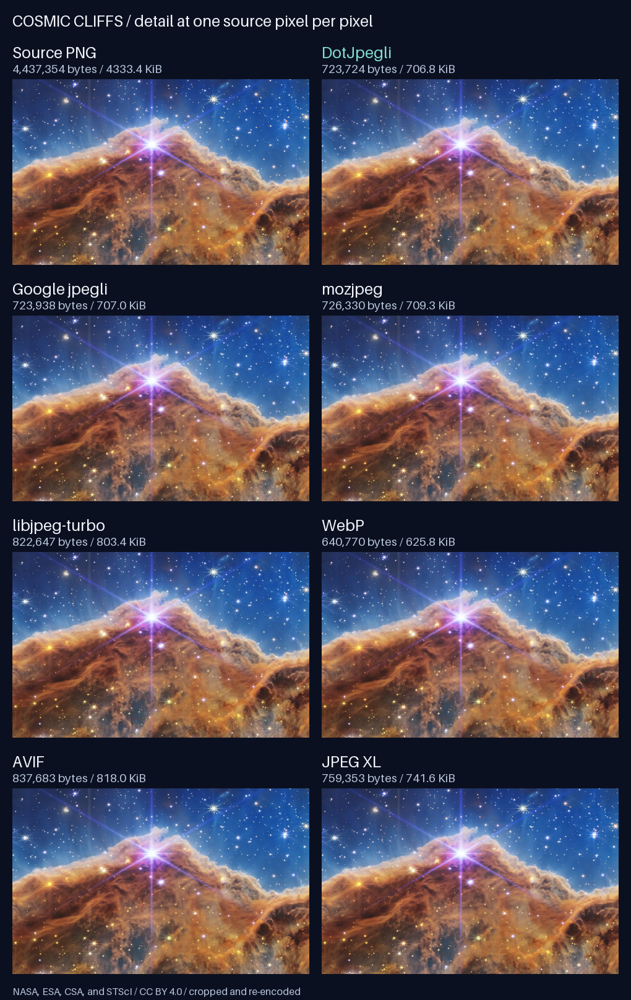

<div align="center">

# DotJpegli

**Pure managed JPEG encoding for .NET.**

[](https://github.com/symbiogenesis/DotJpegli/actions/workflows/ci.yml)
[](https://www.nuget.org/packages/DotJpegli)
[](https://github.com/symbiogenesis/DotJpegli/blob/main/src/DotJpegli/DotJpegli.csproj)
[](https://github.com/symbiogenesis/DotJpegli/blob/main/LICENSE)

[Photograph comparison](#photograph-comparison) · [Quick start](#quick-start) · [Features](#features) · [Performance](#performance) · [Documentation](#documentation)

</div>

DotJpegli is a safe, portable C# JPEG encoder based on
[Google Jpegli](https://github.com/google/jpegli). Encode RGB or grayscale pixels
as baseline or progressive JPEG, with control over quality, sampling, color
profiles, and metadata.

The library is written entirely in managed .NET, with no native dependencies,
P/Invoke, unsafe code, or runtime NuGet dependencies. NativeAOT and trimming are
fully supported on .NET 10 and .NET 11.

## Photograph comparison

Fine clouds of dust, saturated color, and thousands of stars make Webb's
**Cosmic Cliffs** a demanding subject. Open the **2400 × 1390** source photograph
to inspect its full detail:

[](https://raw.githubusercontent.com/symbiogenesis/DotJpegli/main/docs/images/comparison/source.png)

**Photograph: NASA, ESA, CSA, and STScI — [ESA/Webb source](https://esawebb.org/images/weic2205a/),
[CC BY 4.0](https://creativecommons.org/licenses/by/4.0/).** Resized from the
official lossless TIFF; the comparison images are re-encoded and the detail
panels are cropped.

Every encoder receives the same RGB pixels. Links open the complete files;
sizes include headers and metadata. SSIMULACRA2 measures each decoded image
against the source (higher scores indicate closer agreement):

| Encoder / source | Settings | File size | SSIMULACRA2 |
| --- | --- | ---: | ---: |
| [Source PNG](https://raw.githubusercontent.com/symbiogenesis/DotJpegli/main/docs/images/comparison/source.png) | Lossless common input | 4,437,354 bytes · 4333.4 KiB | 100.00 |
| **[DotJpegli 5.0.0](https://raw.githubusercontent.com/symbiogenesis/DotJpegli/main/docs/images/comparison/dotjpegli.jpg)** | Distance 1, 4:2:0, progressive level 2 | **723,724 bytes · 706.8 KiB** | **80.49** |
| [Google's C++ jpegli](https://raw.githubusercontent.com/symbiogenesis/DotJpegli/main/docs/images/comparison/google-jpegli.jpg) | Distance 1, 4:2:0, progressive level 2 | 723,938 bytes · 707.0 KiB | 80.49 |
| [mozjpeg 4.1.1](https://raw.githubusercontent.com/symbiogenesis/DotJpegli/main/docs/images/comparison/mozjpeg.jpg) | Quality 90, 4:2:0, progressive, trellis | 726,330 bytes · 709.3 KiB | 78.92 |
| [libjpeg-turbo 3.2.0](https://raw.githubusercontent.com/symbiogenesis/DotJpegli/main/docs/images/comparison/libjpeg-turbo.jpg) | Quality 90, 4:2:0, progressive | 822,647 bytes · 803.4 KiB | 80.41 |
| [WebP 1.6.0](https://raw.githubusercontent.com/symbiogenesis/DotJpegli/main/docs/images/comparison/webp.webp) | Quality 90, method 6 | 640,770 bytes · 625.8 KiB | 82.28 |
| [AVIF · libavif 1.4.2 / libaom 3.14.1](https://raw.githubusercontent.com/symbiogenesis/DotJpegli/main/docs/images/comparison/avif.avif) | Quality 90, speed 6, 8-bit 4:2:0 | 837,683 bytes · 818.0 KiB | 86.85 |
| [JPEG XL · libjxl 0.12.0](https://raw.githubusercontent.com/symbiogenesis/DotJpegli/main/docs/images/comparison/jpeg-xl.jxl) | Distance 1, effort 7 | 759,353 bytes · 741.6 KiB | 88.02 |

These are representative high-quality settings for one photograph. Quality scales
differ across codecs, so these outputs are **not matched for perceptual quality**.
At the settings shown, JPEG XL and AVIF retain more detail according to SSIMULACRA2.
DotJpegli is 214 bytes smaller than Google's jpegli here; their compressed bytes
and decoded pixels differ slightly. Viewing JPEG XL requires a compatible viewer.

The lossless sheet below shows the same **480 × 300** crop from every image at 1:1
pixel scale. Open it at full size to compare star edges, wispy dust, and color
transitions:

[](https://raw.githubusercontent.com/symbiogenesis/DotJpegli/main/docs/images/comparison/detail-comparison.png)

See [source, exact settings, hashes, and reproduction instructions](https://github.com/symbiogenesis/DotJpegli/blob/main/docs/photo-comparison.md).
Google also published a [human-rater study of jpegli, mozjpeg, and libjpeg-turbo](https://arxiv.org/abs/2403.18589);
the example above was generated separately for this repository.

## Features

| Capability | Support |
| --- | --- |
| **Encoding** | Baseline and progressive JPEG, perceptual quality or distance, chroma subsampling, and custom scan scripts. |
| **Pixel input** | RGB, BGR, grayscale, YCbCr, and XYB layouts; `byte`, `ushort`, and `float` sources; configurable row stride. |
| **Color and metadata** | ICC profiles and source color conversion, Exif, XMP, IPTC, comments, and raw metadata markers. |
| **Output and execution** | Byte arrays or streams, cancellation, and optional parallel encoding. |
| **Portable acceleration** | Managed SIMD on .NET 10 and .NET 11, with scalar fallbacks. |

## Command-line encoder

Download a self-contained NativeAOT `dotjpegli` package or portable archive from
[Releases](https://github.com/symbiogenesis/DotJpegli/releases). Downloads are
available for Windows (x64, ARM64: `.exe`, `.msi`, `.zip`), Linux (x64, ARM64:
`.deb`, `.rpm`, `.AppImage`, `.flatpak`, `.tar.gz`), and macOS (ARM64: `.pkg`,
`.tar.gz`), and do not require .NET to be installed.

```powershell
dotjpegli encode input.png output.jpg --quality 90 --progressive
```

See the [CLI guide](docs/cli.md) for installation, options, and local publishing.

## Quick start

### Install the package

```sh
dotnet add package DotJpegli --version 5.0.0
```

The package targets .NET Standard 2.1, .NET 10, and .NET 11.

### Build from source

Building from source requires **.NET SDK `11.0.100-rc.3.26522.148`**, pinned in
[`global.json`](https://github.com/symbiogenesis/DotJpegli/blob/main/global.json)
with prerelease SDKs enabled.

From the repository root, add a project reference to your application:

```sh
dotnet add path/to/YourApp.csproj reference src/DotJpegli/DotJpegli.csproj
```

### Encode an image

Pass an RGB pixel buffer and its dimensions to the encoder:

```csharp
using DotJpegli;

byte[] rgbPixels = [255, 0, 0]; // One red pixel, in R, G, B order.

byte[] jpeg = JpegliEncoder.Encode(rgbPixels, width: 1, height: 1, options: new()
{
    Quality = 85
});

File.WriteAllBytes("output.jpg", jpeg);
```

For RGB input, the defaults are baseline JPEG, quality 85, and 4:2:0 chroma subsampling.
For other pixel layouts, row padding, and higher-precision sources, see the
[encoding guide](https://github.com/symbiogenesis/DotJpegli/blob/main/docs/encoding.md).
Alpha channels are ignored; composite translucent pixels before encoding.

### Write progressive JPEG to a stream

Write directly to a destination stream and enable progressive encoding:

```csharp
using FileStream output = File.Create("progressive.jpg");

JpegliEncoder.Encode(output, rgbPixels, width: 1, height: 1, options: new()
{
    Quality = 85,
    Progressive = true
});
```

The stream overload avoids allocating a single returned `byte[]` for the entire
JPEG. See [compression and scan options](https://github.com/symbiogenesis/DotJpegli/blob/main/docs/compression.md)
for quality, sampling, and progression controls.

## Performance

These charts compare DotJpegli with **native Google Jpegli** across 24 Kodak photographs.

### Encoding wall time

On an AMD EPYC 9V45, progressive encoding averaged **37.1–41.6% less
time** than native, and sequential encoding averaged **14.2–15.3% less**.


### Allocations per encode

DotJpegli averaged **79.2–109.1 KiB** of managed GC allocations per encode,
compared with **1,924.8–4,288.3 KiB** of native heap requests for Google Jpegli
([measurements](docs/performance-evidence/2026-11-07-be14f89/README.md),
including the output JPEG; not peak memory).


See [methodology and full results](docs/performance-parity.md) and
[chart data](docs/images/performance/metrics.json). All four Kodak photograph
groups pass the native latency bounds, while 15 synthetic control cases exceed
the per-case limit.

## Documentation

| Guide | Topics |
| --- | --- |
| [Encoding](https://github.com/symbiogenesis/DotJpegli/blob/main/docs/encoding.md) | Pixel layouts, sampling, streams, and color spaces. |
| [Profiles and metadata](https://github.com/symbiogenesis/DotJpegli/blob/main/docs/metadata.md) | ICC profiles, Exif, XMP, IPTC, and metadata editing. |
| [Compression and scans](https://github.com/symbiogenesis/DotJpegli/blob/main/docs/compression.md) | Quality, distance, scan scripts, parallel execution, and memory use. |
| [Command-line encoder](https://github.com/symbiogenesis/DotJpegli/blob/main/docs/cli.md) | NativeAOT CLI usage, portable downloads, and platform installers. |
| [Quantization](https://github.com/symbiogenesis/DotJpegli/blob/main/docs/quantization.md) | Standard and custom tables, transfer functions, and advanced tuning. |
| [Development and validation](https://github.com/symbiogenesis/DotJpegli/blob/main/docs/development.md) | Architecture, source builds, focused tests, reproducibility, and NativeAOT checks. |
| [Publishing to NuGet](https://github.com/symbiogenesis/DotJpegli/blob/main/docs/publishing.md) | Trusted publishing setup and releasing tested artifacts from CI. |
| [Quality and compression parity](https://github.com/symbiogenesis/DotJpegli/blob/main/docs/quality-compression-parity.md) | Comparison scope, acceptance bounds, and hosted evidence. |
| [Performance parity](https://github.com/symbiogenesis/DotJpegli/blob/main/docs/performance-parity.md) | Measurement scope, encoding latency, and CI diagnostics. |

## Scope and validation

DotJpegli produces **lossy, 8-bit JPEG**, including from higher-precision
sources and even at quality 100. Jpegli's quality scale is not interchangeable with
libjpeg's. Decoding is outside the project's scope.

Quality and compression parity with upstream is established within a
[documented RGB8 YCbCr scope](https://github.com/symbiogenesis/DotJpegli/blob/main/docs/quality-compression-parity.md).
Byte-identical upstream output is not claimed.
[Performance results and acceptance bounds](https://github.com/symbiogenesis/DotJpegli/blob/main/docs/performance-parity.md)
are documented separately.

## License

Copyright (c) 2026 Edward Miller. Licensed under
[BSD-3-Clause](https://github.com/symbiogenesis/DotJpegli/blob/main/LICENSE), with the
upstream copyright notice retained for adapted portions.
See [third-party notices](https://github.com/symbiogenesis/DotJpegli/blob/main/THIRD-PARTY-NOTICES.md)
for the upstream license and source attribution. The [upstream manifest](https://github.com/symbiogenesis/DotJpegli/blob/main/docs/upstream.json)
records the pinned source revision.

The photograph and its derivatives are licensed separately under
[CC BY 4.0](https://creativecommons.org/licenses/by/4.0/), with full credit
and source links in the comparison above.
