<div align="center">

# DotJpegli

**Pure managed JPEG encoding for .NET.**

[](https://github.com/symbiogenesis/DotJpegli/actions/workflows/ci.yml)
[](https://github.com/symbiogenesis/DotJpegli/actions/workflows/infersharp.yml)
[](https://www.nuget.org/packages/DotJpegli)
[](https://github.com/symbiogenesis/DotJpegli/blob/main/src/DotJpegli/DotJpegli.csproj)
[](https://github.com/symbiogenesis/DotJpegli/blob/main/LICENSE)

[Quick start](#quick-start) · [Features](#features) · [Performance](#performance) · [Documentation](#documentation)

</div>

DotJpegli is a safe, portable C# JPEG encoder based on
[Google Jpegli](https://github.com/google/jpegli). Encode RGB or grayscale pixels
as baseline or progressive JPEG, with control over quality, sampling, color
profiles and metadata.

The library is implemented entirely in managed .NET, with no native dependencies,
P/Invoke, unsafe code or runtime NuGet dependencies.

## Features

| Capability | Support |
| --- | --- |
| **Encoding** | Baseline and progressive JPEG, perceptual quality or distance, chroma subsampling and custom scan scripts. |
| **Pixel input** | RGB, BGR, grayscale and other layouts; `byte`, `ushort` and `float` sources; configurable row stride. |
| **Color and metadata** | ICC profiles and source color conversion, Exif, XMP, IPTC, comments and raw metadata markers. |
| **Output and execution** | Byte arrays or streams, cancellation and optional parallel encoding. |
| **Portable acceleration** | Managed SIMD on .NET 10 and .NET 11, with scalar fallbacks. |

## Command-line encoder

Download the self-contained NativeAOT `dotjpegli.exe` or Windows MSI from
[Releases](https://github.com/symbiogenesis/DotJpegli/releases). Packages are
available for x64 and ARM64 and do not require .NET to be installed.

```powershell
dotjpegli encode input.png output.jpg --quality 90 --progressive
```

See the [CLI guide](docs/cli.md) for installation, options and local publishing.

## Quick start

### Reference the project

Building from source requires **.NET SDK `11.0.100-rc.3.26522.148`**, pinned in
[`global.json`](https://github.com/symbiogenesis/DotJpegli/blob/main/global.json)
with prerelease SDKs enabled.

From this repository's root, add a project reference to your application.
Replace `path/to/YourApp.csproj` with your application's project path:

```sh
dotnet add path/to/YourApp.csproj reference src/DotJpegli/DotJpegli.csproj
```

### Encode an image

Pass an RGB pixel buffer and its dimensions to the encoder:

```csharp
using DotJpegli;

byte[] rgbPixels = [255, 0, 0]; // One red pixel, in R, G, B order.

byte[] jpeg = JpegliEncoder.Encode(rgbPixels, width: 1, height: 1, options: new()
{
    Quality = 85
});

File.WriteAllBytes("output.jpg", jpeg);
```

For RGB input, the defaults are baseline JPEG, quality 85 and 4:2:0 chroma subsampling.
For other pixel layouts, row padding and higher-precision sources, see the
[encoding guide](https://github.com/symbiogenesis/DotJpegli/blob/main/docs/encoding.md).
Alpha channels are ignored; composite translucent pixels before encoding.

### Write progressive JPEG to a stream

Using the same pixel buffer, write directly to a destination stream and enable
progressive encoding:

```csharp
using FileStream output = File.Create("progressive.jpg");

JpegliEncoder.Encode(output, rgbPixels, width: 1, height: 1, options: new()
{
    Quality = 85,
    Progressive = true
});
```

The stream overload avoids retaining the complete encoded JPEG in a returned
byte array. See [compression and scan options](https://github.com/symbiogenesis/DotJpegli/blob/main/docs/compression.md)
for quality, sampling and progression controls.

## Compatibility and deployment

| Target | Implementation and deployment |
| --- | --- |
| .NET Standard 2.1 | The same public encoding and metadata APIs, with scalar DCT and quantization paths. |
| .NET 10 | Portable SIMD acceleration; compatible with trimming and NativeAOT. |
| .NET 11 | Newer portable SIMD APIs; compatible with trimming and NativeAOT. |

To publish an application that references DotJpegli, select its target framework
and runtime identifier. For example, publish a .NET 10 application for Linux x64
with trimming or NativeAOT:

```sh
dotnet publish path/to/YourApp.csproj -c Release -f net10.0 -r linux-x64 --self-contained true -p:PublishTrimmed=true
dotnet publish path/to/YourApp.csproj -c Release -f net10.0 -r linux-x64 -p:PublishAot=true
```

Use `net11.0` for a .NET 11 application and the RID for your deployment platform.
NativeAOT requires the platform's
[native build tools](https://learn.microsoft.com/dotnet/core/deploying/native-aot/#prerequisites).
DotJpegli requires no additional linker descriptors or preservation attributes.

CI publishes and runs trimmed and NativeAOT consumers on Windows and Linux x64
for both .NET targets. Linker and AOT analyzer warnings fail validation. See
[deployment validation](https://github.com/symbiogenesis/DotJpegli/blob/main/docs/development.md#trimming-and-nativeaot)
for coverage.

## Performance

Compare DotJpegli with **native Google Jpegli** on all 24 Kodak photographs.
The charts use fresh measurements from **November 3, 2026**,
[CI run 41603913358](https://github.com/symbiogenesis/DotJpegli/actions/runs/41603913358),
testing revision `f52961b`. Compression and time differences are relative to
native; zero means equal file size or encoding time.

### Compression efficiency

JPEG sizes are nearly identical at the same measured quality. Photograph group
means differ from native by **at most 0.002%** across all four encoding modes at
matched PSNR and SSIM. The summary rounds the largest absolute difference up to
the next 0.001%; exact group values are linked below.


### Encoding wall time

On the measured AMD EPYC 9V74 host, progressive photograph encoding used
**about 20% less time** than native; sequential encoding used **13.5–16.1% more**.
Bars show the percentage change in encoding time, with photographs and controls
paired under each encoding mode. Left of zero means less time; right means more.



### Managed allocations

Each bar shows average managed allocations per complete encode, including the
returned JPEG. Native allocations were not measured. Retained pool capacity
and peak memory are outside this measurement.


The time and allocation comparison uses distances 1/4, both sampling modes,
one worker and tiered compilation disabled. The complete 256-case comparison
includes eight deterministic controls; full performance parity remains
unestablished. See the [retained measurements](docs/performance-evidence/2026-11-03-f52961b/README.md),
[chart values](docs/images/performance/metrics.json) and
[reproducible protocol](docs/performance-parity.md) for the host, runtime,
raw samples and individual regressions.

## Documentation

| Guide | Topics |
| --- | --- |
| [Encoding](https://github.com/symbiogenesis/DotJpegli/blob/main/docs/encoding.md) | Pixel layouts, sampling, streams and color spaces. |
| [Profiles and metadata](https://github.com/symbiogenesis/DotJpegli/blob/main/docs/metadata.md) | ICC profiles, Exif, XMP, IPTC and metadata editing. |
| [Compression and scans](https://github.com/symbiogenesis/DotJpegli/blob/main/docs/compression.md) | Quality, distance, scan scripts, parallel execution and memory use. |
| [Quantization](https://github.com/symbiogenesis/DotJpegli/blob/main/docs/quantization.md) | Standard and custom tables, transfer functions and advanced tuning. |
| [Development and validation](https://github.com/symbiogenesis/DotJpegli/blob/main/docs/development.md) | Source builds, focused tests, reproducibility and deployment checks. |
| [Publishing to NuGet](https://github.com/symbiogenesis/DotJpegli/blob/main/docs/publishing.md) | Trusted publishing setup and publishing a tested package from CI. |
| [Quality and compression parity](https://github.com/symbiogenesis/DotJpegli/blob/main/docs/quality-compression-parity.md) | Comparison scope, acceptance bounds and hosted evidence. |
| [Performance parity](https://github.com/symbiogenesis/DotJpegli/blob/main/docs/performance-parity.md) | Measurement scope, encoding latency and CI diagnostics. |

## Scope and validation

DotJpegli produces **lossy, eight-bit JPEG**, including from higher-precision
sources and even at quality 100. Jpegli's quality scale is not interchangeable with
libjpeg's. Decoding is outside the project's scope.

Quality and compression parity with upstream is established within a
[documented RGB8 YCbCr scope](https://github.com/symbiogenesis/DotJpegli/blob/main/docs/quality-compression-parity.md).
Byte-identical upstream output is not claimed.
[Performance results and acceptance bounds](https://github.com/symbiogenesis/DotJpegli/blob/main/docs/performance-parity.md)
are documented separately.

## License

Copyright (c) 2026 Edward Miller. Licensed under
[BSD-3-Clause](https://github.com/symbiogenesis/DotJpegli/blob/main/LICENSE), with the
upstream copyright notice retained for adapted portions.
See the [upstream license](https://github.com/symbiogenesis/DotJpegli/blob/main/LICENSE.jpegli)
and [third-party notices](https://github.com/symbiogenesis/DotJpegli/blob/main/THIRD-PARTY-NOTICES.md)
for attribution. The [upstream manifest](https://github.com/symbiogenesis/DotJpegli/blob/main/docs/upstream.json)
records the pinned source revision.
